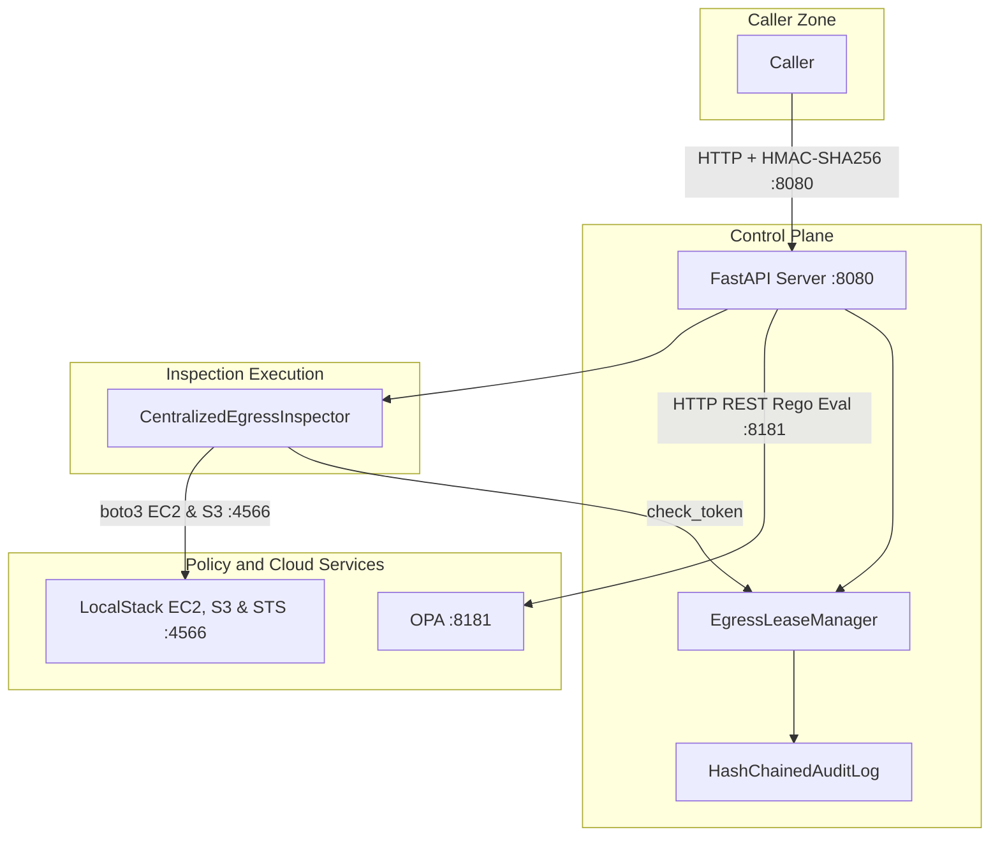
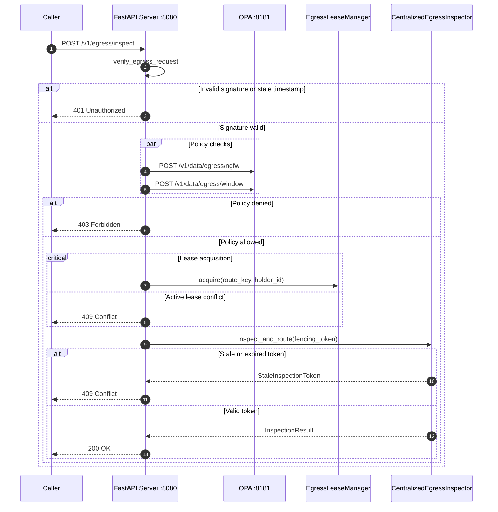
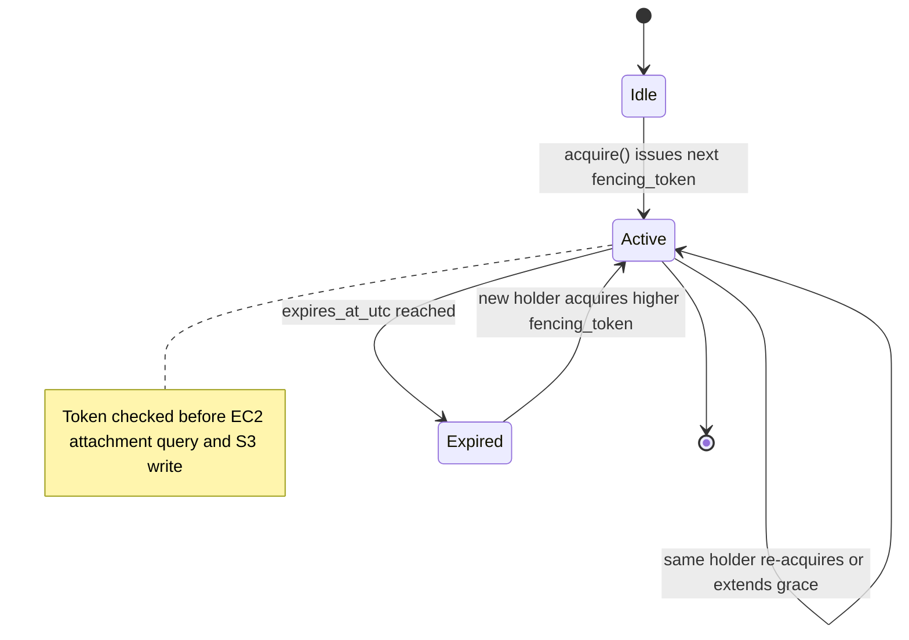

# Design Notes: Centralized Egress Inspection with Next-Gen Firewalls

This service separates lease and hash-chained audit logging (`src/egress_ngfw/inspector.py`, `src/egress_ngfw/server.py`, `storage/audit_log.py`) from centralized egress routing and AWS EC2/S3 recording (`CentralizedEgressInspector`) with Open Policy Agent (OPA) policy evaluation.

## Trust-Boundary and Network Enclave Topology

## Inspection and Failure Sequence

## Route Lease Lifecycle

## Trade-Offs and Limitations

Timestamps and UTC change windows use UTC so Daylight Saving Time transitions do not shift allowed hours. Off-window changes permit up to a 15-minute grace extension when an active incident ID is supplied. AWS calls retry transient errors up to 4 times with per-retry delay capped at `2.0s`.

Limitations: `EgressLeaseManager` and `HashChainedAuditLog` are in-memory per process, and `describe_transit_gateway_attachments` reads the initial page without `NextToken` pagination.
