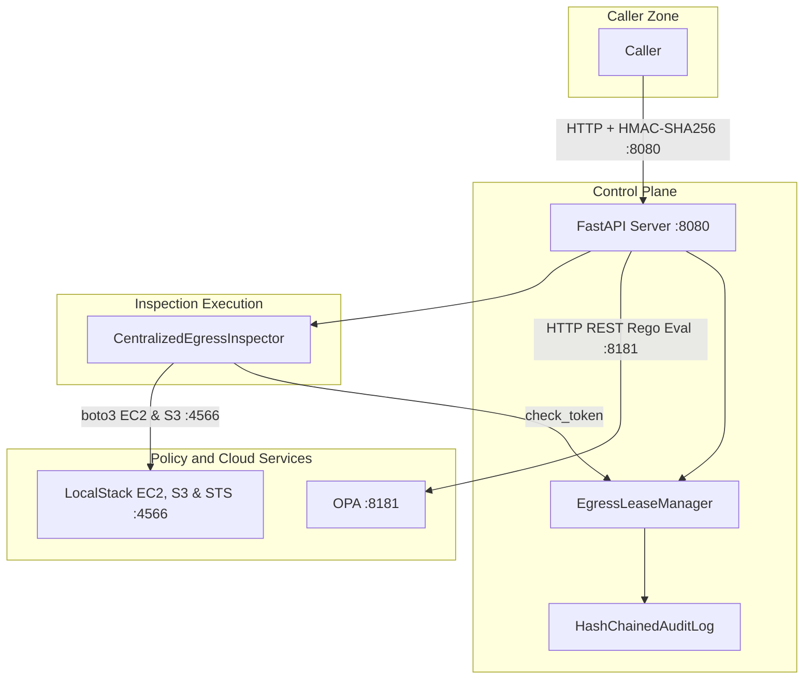

# centralized-egress-ngfw-inspection

Built and tested on Python 3.12.

Python FastAPI service and inspection controller for centralized egress routing through next-gen firewall profiles (`tls-inspect-strict`, `dns-l7-guard`, `egress-default-inspect`), backed by monotonic fencing tokens, SHA-256 hash-chained audit events, OPA policies, and AWS EC2/S3 calls.



## Prerequisites

- Python 3.12+
- Docker and Docker Compose
- `curl` and `openssl`

## Environment Variables

| Variable | Default | Purpose |
| --- | --- | --- |
| `AWS_REGION` | `us-east-1` | AWS region for EC2, S3, and STS clients |
| `AWS_ENDPOINT_URL` | `http://localhost:4566` | LocalStack or custom AWS endpoint URL |
| `EGRESS_AUDIT_BUCKET` | `centralized-egress-ngfw-audit` | S3 bucket receiving inspection records and preflight probes |
| `OPA_URL` | `http://localhost:8181` | Open Policy Agent base URL |
| `WEBHOOK_HMAC_SECRET` | `local-dev-egress-ngfw-secret` | Shared secret for `X-Signature-256` verification |

## Setup Order and Commands

Start LocalStack (`ec2,s3,sts`) and OPA:

```bash
make up
```

Run the live preflight probe (`make doctor`), seed baseline routes (`make seed`), and start the API server (`make run`):

```bash
make doctor
make seed
make run
```

Run unit, chaos, and benchmark checks:

```bash
make test
make chaos
make bench
```

Stop containers:

```bash
make down
```

## Sample Request

```bash
BODY='{"source_cidr":"10.50.1.0/24","destination_port":443,"protocol":"tcp","ngfw_profile":"tls-inspect-strict","holder_id":"ngfw-worker-1","operator_role":"sec-ngfw"}'
TS=$(date -u +%s)
SIG="sha256=$(printf '%s.%s' "$TS" "$BODY" | openssl dgst -sha256 -hmac 'local-dev-egress-ngfw-secret' | awk '{print $2}')"

curl -s -X POST http://localhost:8080/v1/egress/inspect   -H "Content-Type: application/json"   -H "X-Timestamp: $TS"   -H "X-Signature-256: $SIG"   -d "$BODY"
```

## Measured Output

From running `python3 -m unittest discover -s tests -p "test_*.py" -v`:

- `Ran 5 tests in 0.065s` (`OK`).
- `BENCH lease+check+audit (2000 ops): 48.17 ms (24.08 us/op)`.

## Common Errors and Fixes

- `x s3 write/delete probe failed on bucket=...: An error occurred (AccessDenied) when calling the PutObject operation`: the configured IAM principal or bucket policy lacks `s3:PutObject` or `s3:DeleteObject`; grant write/delete permissions on `EGRESS_AUDIT_BUCKET` or verify `AWS_ENDPOINT_URL`.
- `x opa health probe failed at http://localhost:8181`: the OPA container is still starting or stopped; run `make up` and wait for health checks to pass.

## Not Wired Yet

- No external relational or distributed database backing `EgressLeaseManager` or `HashChainedAuditLog` across multiple processes.
- No direct vendor NGFW appliance SDK (such as Palo Alto Panorama or Fortinet FortiManager API calls); mutations are recorded to S3 after EC2 attachment inspection.
- No pagination loop over `describe_transit_gateway_attachments` `NextToken`.
